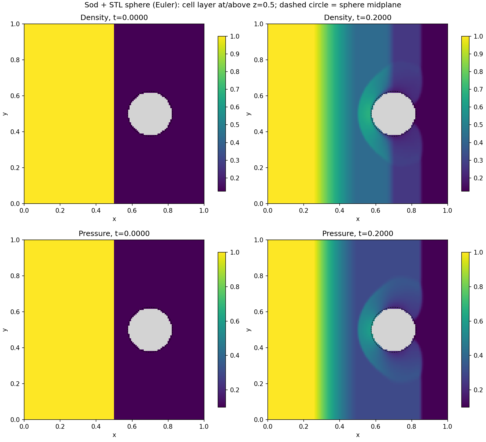

# sod_eb_stl：通过 STL 构建球体的 Sod 算例

## 从 GitHub 下载后构建

需要 Linux/WSL、支持 C++20 的编译器（本机验证为 GCC 11）、CMake 3.25 或更新版本、Python 3。AMReX 不包含在本仓库中，下面固定到已验证的提交：

```bash
git clone https://github.com/briandontloseyourheart-maker/sod-eb-stl.git
git clone https://github.com/AMReX-Codes/amrex.git
git -C amrex checkout 2399452da8054029a92c5309a4bccb3102c109fd
cd sod-eb-stl
cmake -S . -B build -DCMAKE_BUILD_TYPE=Release -DAMREX_SOURCE_DIR=../amrex
cmake --build build -j 8
ctest --test-dir build --output-on-failure
python3 tools/run.py --output results/sphere_stl --threads 4
```

绘图可在 Python 虚拟环境中安装依赖：

```bash
python3 -m venv .venv
source .venv/bin/activate
python -m pip install -r requirements.txt
python tools/plot.py results/sphere_stl
```

运行和检查不依赖 NumPy/Matplotlib，只有绘图及切片对比需要它们。`docs/example/fields.png` 和 `validation.json` 是已完成算例的示例成果，完整运行数据由用户重新生成。



以下章节同时保留原工作区的目录位置，下载者应以本节相对路径为准。比较工具中的 `../sod_eb2` 是可选的本地基准工程，不影响本仓库独立构建和运行。

本项目与 `../sod_eb2` 使用相同的 C++ CNS、Sod 初值、球体尺寸、边界条件和 AMR 设置，区别是 **用 STL 三角面构建 EB，而不是解析 sphere**。原算例和原始 Fortran 教程保持不变。

```text
sod_eb_stl/
├── CMakeLists.txt
├── src/                     # 主程序、复合诊断、problem/ 和 solver/
├── cases/sphere_stl/inputs   # STL 算例配置
├── geometry/
│   ├── sphere.stl           # 已生成的封闭二进制球面 STL
│   └── audit.json           # 三角面/体积/法向/哈希检查
├── tools/                   # 几何生成、运行、检查、绘图、对比
├── tests/                   # CTest STL + AMR 测试
├── docs/                    # 验证记录
├── build/                   # 构建产物
└── results/sphere_stl/      # 已完成的实验
```

## 构建

独立从本地 AMReX 源码构建，不需要联网：

```bash
cd /home/xiaohui/codes/myamrex_5/sod_eb_stl
cmake -S . -B build -DCMAKE_BUILD_TYPE=Release
cmake --build build -j 8
ctest --test-dir build --output-on-failure
```

默认 `AMREX_SOURCE_DIR=../../amrex`。也支持标准 CMake `find_package` 复用已构建的 AMReX，**本次实际验证使用此方式**：

```bash
cmake -S . -B build -DCMAKE_BUILD_TYPE=Release \
  -DAMReX_DIR=/home/xiaohui/codes/myamrex_5/sod_eb2/build/amrex/lib/cmake/AMReX
cmake --build build -j 8
```

此配置引用 sod_eb2 的 AMReX 构建库；以后若删除它，应改用 `cmake -S . -B build -UAMReX_DIR` 切回源码构建。本程序自己的源文件仍单独编译，CPU/OpenMP、单 MPI 进程；不支持 GPU/MPI CSV 导出。

## 运行和查看

```bash
python3 tools/run.py --output results/sphere_stl_02 --threads 4
python3 tools/plot.py results/sphere_stl_02
```

已有默认结果位于 `results/sphere_stl`。运行器拒绝覆盖非空目录，将 inputs 与精确使用的 STL 一起复制到新目录，记录实际命令、线程数、STL SHA256 和进程退出码。直接运行可执行文件时，必须先把 geometry/sphere.stl 复制到运行目录，或在命令行覆盖 `eb2.stl_file=/absolute/path/to/sphere.stl`。

- `fields.png`：初始/最终密度、压力云图；灰色为固体，黑虚线是解析球的中心截面参考轮廓。
- `diagnostics.csv` / `.png`：每步复合 AMR 体积、质量、总能量和正性。
- `slice_initial.csv`、`slice_final.csv`：z=0.5 所在单元层，实际中心 z 随层级略有不同；固体行的状态值是占位值，不能当作流体状态。
- `pltXXXXX/`：ParaView 的 AMReX/BoxLib Grid Reader 读取。
- `run.json`、`inputs.used`、`sphere.stl`、`validation.json`：运行来源及验证。

ParaView 中可执行 `tools/paraview_view.py`（View → Python Shell → Run Script）加载默认结果时间序列。也可手动 Slice：Origin=(0.5,0.5,0.5)，Normal=(0,0,1)。STL 本身没有流场变量；可单独叠加 geometry/sphere.stl 观察位置。脚本未在 Windows ParaView 实测。

## inputs 中关键变化

```ini
eb2.geom_type = stl
eb2.stl_file = sphere.stl
eb2.stl_scale = 1
eb2.stl_center = 0 0 0
eb2.stl_reverse_normal = 0
eb2.stl_use_bvh = 1
eb2.cover_multiple_cuts = 0
```

STL 顶点**已经包含**球心 (0.7,0.5,0.5) 和半径 0.125，因此不能再把 stl_center 设成球心，否则会额外平移。STL 不自带单位，此处坐标沿用无量纲 Sod 的 [0,1]³ 区域，不做毫米转米。

球面网格使用 128 个经向区间、64 个纬向区间，16128 个三角形。每条边恰有两个方向相反的相邻面，欧拉特征为 2；法向向外，没有退化面。三角面包围体积比解析球小约 0.10036%。重新生成：`python3 tools/generate_sphere.py`，固定分辨率和球心，不会修改输入原始模型。

## 与解析球体版本保持一致的设置

无量纲 Euler、gamma=1.4；x=0.5 左右 (rho,p,u)=(1,1,0)/(0.125,0.1,0)；x 两端外流，y/z 对称反射；球面不可穿透无黏；64³ 粗网格 + Level 1 比例 2，最细 dx=1/128；按切割单元及密度差加密；终止 t=0.2。

这里比较的是几何表示方式。STL 是平面三角片近似曲面，EB 切割体积和流场不应期待与解析 sphere 逐位相同；几何检查、正性与守恒通过也不等于完成网格收敛验证。

已有解析球结果时可比较最终切片：

```bash
python3 tools/compare.py results/sphere_stl ../sod_eb2/results/sphere
```

比较把两种复合切片按单元常值铺到共同的细网格，只统计两者共同流体区域。不是新的求解，也不是完整三维误差范数。
