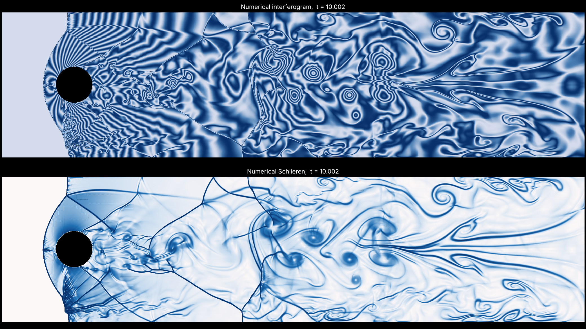

# brian_20261020_0732: supersonic flow around a cylinder (Mach 3, STL, 2D)

Mach 3 flow past a circular cylinder in a channel of height 4 D with slip walls.
The bow shock reflects off the channel walls, the reflected shocks cross the wake,
and the wake behind the cylinder sheds vortices. The cylinder is an STL.



## Build, run, plot

```bash
# from the repository root, AMReX checked out next to it (same commit as the main README)
cmake -S brian_20261020_0732 -B build-cyl -DAMREX_SOURCE_DIR=../amrex
cmake --build build-cyl -j 8
mkdir -p results/cyl && cd results/cyl
cp ../../brian_20261020_0732/inputs ../../brian_20261020_0732/cylinder.stl .
OMP_NUM_THREADS=8 ../../build-cyl/bin/cylinder_mach3 inputs
python3 ../../shock_wedge/tools/wedge_images.py plt0XXXX --k 25 --drho 0.25   # Schlieren + interferogram
python3 ../../shock_wedge/tools/wedge_images.py . --all --k 25 --drho 0.25     # every frame, for a movie
```

A checkpoint is written every 5 time units; continue a run with `amr.restart=chkXXXXX`.
For an animation, use a fixed Schlieren scale so the frames don't flicker, then join them:

```bash
python3 ../../shock_wedge/tools/wedge_images.py . --all --k 25 --drho 0.25 --gmax 100 --out frames
ffmpeg -framerate 20 -pattern_type glob -i 'frames/plt*.png' -vf "pad=ceil(iw/2)*2:ceil(ih/2)*2" -c:v libx264 -pix_fmt yuv420p -crf 18 cylinder.mp4
```

In ParaView, `../shock_wedge/tools/paraview_schlieren.py` gives the same Schlieren.

## Setup

| | value |
|---|---|
| Domain | x 0 to 16, y -2 to 2 (D = 1) |
| Cylinder | `cylinder.stl`, diameter 1, centre (1.9937, 0.0031), 512 facets, extruded in z |
| Freestream | rho = 1, p = 1/gamma (c = 1), u = 3 (M = 3), gamma = 1.4 |
| Grid | 256 x 64 base (dx = D/16), 3 levels of ratio 2, finest dx = D/128 |
| x boundaries | supersonic inflow of the freestream (1) / outflow (2) |
| y boundaries | slip walls (3) |
| Refinement | cut cells, and density jump > 0.05 between neighbours |
| Run | to t = 20 (3.75 flow-through times) |

Units: lengths in D, time in D/c. The freestream crosses the domain in 5.3 time units.

### What is needed to make it run

1. **Start-up.** Filling the whole domain with Mach 3 flow at t = 0 makes the gas
   behind the cylinder pull away from its rear wall into near-vacuum, and the run
   blows up in the first step (negative density in the rear cut cells, time step
   collapses to 0). Instead the gas starts at rest for x > `prob.x_start` = 1 and
   the Mach 3 stream enters behind a start-up shock, which sweeps past the cylinder
   and leaves the domain.
2. **Cylinder position.** With the centre at exactly (2, 0) the cylinder touches
   grid lines at its front, back, top and bottom, which makes degenerate cut
   cells. The small offset avoids that and also breaks the up-down symmetry, so the
   wake starts shedding vortices on its own.
3. **Limiter and redistribution weights.** Even then, with the solver's default
   MC slope limiter and equal flux-redistribution weights, the start-up shock
   hitting the small cut cells on the cylinder face drove the pressure negative
   there (same with an exact analytic circle, so it is not the STL). The inputs use
   `cns.plm_theta = 1` (minmod) and `cns.eb_weights_type = 3` (volume-fraction
   weights); `../src/solver/CNS.cpp` now reads `cns.plm_theta` and `cns.plm_iorder`
   from the inputs (defaults unchanged, so the other cases are not affected).
4. **Cut cells on the shoulders.** Later (t = 1.3 to 11, depending on the grid) the
   expansion over the cylinder's top and bottom drove a few tiny cut cells to
   negative pressure and unphysical speeds (10 to 300, while Mach 3 flow cannot go
   faster than u_max = 3.74), and the time step collapsed to 0. Four new, opt-in
   solver options fix it; all are off by default, so the other cases are unchanged:
   - `cns.eb_first_order = 1`: zero slopes (first order) in cut cells only;
   - `cns.floor_rho`, `cns.floor_p` = 1e-3: density and pressure floors;
   - `cns.floor_vmax = 6`: speed cap; the kinetic energy removed stays in the total
     energy, so energy is conserved;
   - `eb2.small_volfrac = 0.01` merges the very smallest cut
     cells (volume fraction < 1 %) at D/128. Larger values (0.05, 0.1) made it worse.

   Also fixed: `cns.plm_iorder = 1` crashed 2D runs (it wrote a 5th slope component
   into a 4-component array).

## Files

- `src/`: freestream initial state and supersonic inflow boundary. `main.cpp`, the
  EB setup and the solver are shared with `../shock_wedge/src` and `../src/solver`.
- `tools/generate_cylinder_stl.py`: writes `cylinder.stl` (`--center`, `--radius`,
  `--segments`). Any closed STL works in its place.

The reference picture is likely viscous (Navier-Stokes); this case is inviscid
Euler, so the shear layers roll up through numerical dissipation and their fine
structure depends on the grid.
