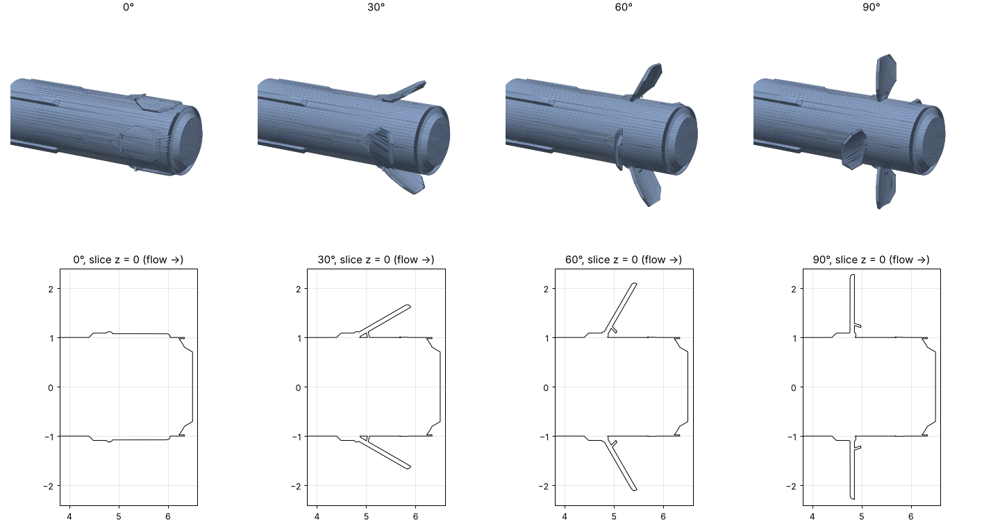

# brian_20261022_0311: brake plates opening, steady Mach 2 flight (3D, STL)

The body from `../brake_shock_3d/brake.stl` flying nose first at Mach 2, with its four brake
plates at 0°, 30°, 60° and 90°. Each angle is a separate steady run. A real brake opens in
0.1 to 1 s, while the air passes the body in about a thousandth of that, so at every moment
of opening the flow is the steady flow for the current angle; four steady runs give that flow
and a drag-against-angle curve.



## Geometry

`tools/make_brake_angles.py` makes `brake_000.stl` … `brake_090.stl` from your 90° STL:

- each plate (curved panel at x = 4.77 to 4.98, out to r = 2.28) is cut out and rotated about
  its hinge (the two pins in the STL, at x = 4.81, r = 1.045), so it swings out from the
  body with its tip toward the tail; 0° = folded flat on the body, 90° = as in your STL;
- the thin strut behind each plate is removed at every angle (its shape at other angles is not
  known), so `brake_090.stl` is your geometry without struts;
- the result is one closed solid per angle (mesh booleans with trimesh + manifold3d).

```bash
python3 -m pip install trimesh manifold3d networkx scipy
python3 tools/make_brake_angles.py ../brake_shock_3d/brake.stl --angles 0 30 60 90 --out .
```

Any other angle works too (`--angles 45`).

## Build, run, plot

```bash
# from the repository root, AMReX checked out next to it (same commit as the main README)
cmake -S brian_20261022_0311 -B build-brk2 -DAMREX_SOURCE_DIR=../amrex
cmake --build build-brk2 -j 8
for a in 000 030 060 090; do
  mkdir -p results/brake$a && cd results/brake$a
  cp ../../brian_20261022_0311/inputs ../../brian_20261022_0311/brake_$a.stl .
  OMP_NUM_THREADS=8 ../../build-brk2/bin/brake_mach2 inputs eb2.stl_file=brake_$a.stl
  cd ../..
done
# Schlieren / interferogram on the plane through the +y plate (z = 0.01) and between plates
python3 shock_wedge_3d/tools/slice_images.py results/brake090/plt0XXXX --slice z=0.01 --k 20 --drho 0.1
# drag coefficient: every run's forces.dat, with its angle
python3 brian_20261022_0311/tools/drag_plot.py results/brake000/forces.dat:0 results/brake030/forces.dat:30 \
        results/brake060/forces.dat:60 results/brake090/forces.dat:90
```

## Setup

| | value |
|---|---|
| Body | nose at x = 0, flat base at x = 6.5, radius 1.0 to 1.12; plates at x ≈ 4.8 |
| Flow | Mach 2 along +x, nose first; rho = 1, p = 1/gamma (sound speed 1), u = 2 |
| Domain | quarter x -2 to 10, y and z 0 to 5; symmetry planes y = 0 and z = 0 |
| Grid | 96 x 40 x 40 base (dx = 0.125), 2 levels of ratio 2, finest dx = 0.031 |
| Plate region | always refined to the finest level (x 4.55 to 6.2, r < 2.45) |
| Run | t = 8 (1.3 flow-throughs of the domain); a run takes about 1.5 to 2 h on 4 cores |
| Output | plotfile every 1 time unit; `forces.dat` every 5 coarse steps |

### Drag output (new solver option)

`cns.force_int = 5` makes the solver add up the pressure on the body every 5 coarse steps and
append `time Fx Fy Fz` to `forces.dat` (pressure relative to `cns.force_pref`, the
freestream pressure). The sum uses each cut cell's face apertures, so it is the exact
discrete pressure force. It is the force on the computed quarter: the whole-body drag is
4 Fx, and `tools/drag_plot.py` turns it into C_D = 4 Fx / (0.5 rho u² π R²), R = 1.118.
Fy and Fz are not meaningful for a quarter (they cancel with the mirror images).

The solver is inviscid, so this is pressure drag only (no skin friction). For a brake that is
most of the drag, but absolute values in the separated wake behind the plates are approximate.

### What was needed to make it run

1. **Plates invisible on coarse grids.** The plates are 0.088 thick. The STL is sampled at
   grid nodes, so a grid of dx = 0.125 does not see them at all, and the refinement never
   gets there. `cns.refine_box_lo_0/hi_0` forces the finest level around the plates.
2. **Tiny cut cells on the nose** (volume fraction ~1e-7) drained to near vacuum and cut the
   time step 10 times. `eb2.small_volfrac = 1e-4` merges them (larger values fail to build
   the geometry for some angles), and the floors are raised to `floor_rho = 0.05`,
   `floor_p = 0.01` (the gas in this flow never gets that thin, so only those cells are
   touched). The speed cap is 4 (Mach 2 air cannot exceed 3).
3. **Start-up.** Starting with still air downstream (as in the cylinder case) makes the
   incoming air collide with it and leaves a slow shock that needs ~50 time units to leave.
   Here the whole domain starts at the freestream (`prob.x_start = 100`).
4. Also changed in the solver: covered cells (no gas) no longer count in the time-step
   estimate; `cns.v = 3` prints the cell that limits the time step on each level.

## Files

- `brake_000.stl` … `brake_090.stl`: the four geometries.
- `inputs`: one inputs file for all angles; pick the STL with `eb2.stl_file=`.
- `tools/make_brake_angles.py`: makes the STLs. `tools/drag_plot.py`: C_D plot.
- The freestream setup and inflow boundary are shared with `../brian_20261020_0732/src`,
  `main.cpp` and the EB setup with `../shock_wedge/src`, the solver with `../src/solver`.
