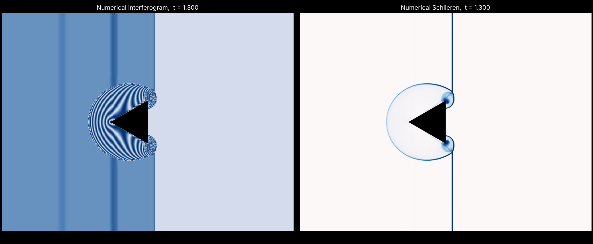

# shock_wedge: Mach 1.3 shock diffraction over a finite triangular wedge (2D)

Reproduces the classic "numerical interferogram + Schlieren" picture of a planar
M = 1.3 shock passing a finite wedge whose apex points upstream. It reuses the
CNS solver in `../src/solver` unchanged; only the problem setup lives here.



## Build, run, plot

```bash
# from the repository root, AMReX checked out next to it (same commit as the README)
cmake -S shock_wedge -B build-wedge -DAMREX_SOURCE_DIR=../amrex
cmake --build build-wedge -j 8
mkdir -p results/wedge && cd results/wedge
cp ../../shock_wedge/inputs .
OMP_NUM_THREADS=4 ../../build-wedge/bin/shock_wedge inputs     # ~20 s on 4 cores
# STL geometry instead: cp ../../shock_wedge/inputs_stl ../../shock_wedge/wedge.stl .
#                       ../../build-wedge/bin/shock_wedge inputs_stl
python3 ../../shock_wedge/tools/wedge_images.py plt00246       # last plotfile
python3 ../../shock_wedge/tools/wedge_images.py . --all        # every frame, for a movie
# ffmpeg -framerate 10 -pattern_type glob -i 'images/plt*.png' -pix_fmt yuv420p wedge.mp4
```

This is a separate 2D build (`AMReX_SPACEDIM=2`); the 3D sphere build in the root
`CMakeLists.txt` is untouched. The plot tool reads AMReX plotfiles directly and
needs only NumPy and Matplotlib.

## What changed compared with the Sod/STL sphere case

| | sod-eb-stl (3D) | shock_wedge (2D) |
|---|---|---|
| Geometry | `eb2.geom_type = stl`, sphere.stl | `stl` with wedge.stl (`inputs_stl`), or implicit `wedge` (`inputs`) |
| Initial state | Sod left/right states | Rankine-Hugoniot jump for `prob.mach` into still gas |
| x-lo boundary | outflow (2) | inflow (1) holding the post-shock state, `src/CNS_bcfill.cpp` |
| y boundaries | symmetry (3) | symmetry / slip wall (3) |
| Diagnostics | composite CSV in 3D | dropped; images from plotfiles |

### Geometry
Two equivalent ways to describe the wedge; both give the same flow (only the two
base-corner cells differ slightly).

1. **STL, like your sphere case** (`inputs_stl`, `eb2.geom_type = stl`). In a 2D
   build AMReX cuts the STL with the plane z = 0, so the STL is the triangle
   extruded in z: `wedge.stl` is an 8-triangle closed prism made by
   `tools/generate_wedge_stl.py` (options `--apex --length --half-angle`).
   Copy `wedge.stl` into the run folder, as with `sphere.stl`.
2. **Implicit function** (`inputs`, `eb2.geom_type = wedge`): the minimum signed
   distance to the three edges (positive inside the body, the EB2 convention),
   in `src/WedgeIF.H`, set by `wedge.apex_x/apex_y/length/half_angle`.

The default is an equilateral triangle (30 deg half-angle) with the apex
upstream at (3, 0), like the target image. `eb2.cover_multiple_cuts = 1` lets
AMReX handle the cells at the sharp corners. Any other `eb2.geom_type` still goes
to AMReX's built-ins.

### Initial condition (Rankine-Hugoniot)
Still gas: rho_1 = 1, p_1 = 1/gamma, so c_1 = 1 and the shock speed W = M.
For gamma = 1.4 and M = 1.3 (computed in `src/cns_prob.cpp` and printed at start):

| | rho | p | u |
|---|---|---|---|
| ahead (still) | 1 | 0.714286 | 0 |
| behind | 1.515695 | 1.289286 | 0.442308 |

rho_2/rho_1 = (g+1)M^2/((g-1)M^2+2), p_2/p_1 = 1 + 2g(M^2-1)/(g+1),
u_2 = W (1 - rho_1/rho_2). The flow behind the shock is subsonic (u_2/c_2 = 0.41).

### Domain and AMR
[0,8] x [-3,3] in wedge lengths, apex at (3,0), base at x = 4, shock starts at
x = 2.5 (reaches the apex at t = 0.385, the base at t = 1.154). 256 x 192 base
grid, 2 levels of ratio 2 (finest dx = L/128). Cells are tagged at cut cells and
where the density jump between neighbours exceeds 0.01. Set `amr.max_level = 3`
for L/256.

### Post-processing (`tools/wedge_images.py`)
- Schlieren: S = exp(-k |grad rho| / max |grad rho|), k = 15 (`--k`).
- Interferogram: I = cos^2(pi (rho - rho_ref) / drho), one fringe per `--drho`
  (default 0.02). Smaller drho gives more fringes.

### Notes
- The two faint vertical bands left of the wedge in the interferogram are
  start-up waves from the sharp initial jump (an entropy wave at x = 2.5 + u_2 t
  and a weak left-running acoustic wave). The target image shows a similar line.
  Start the shock further left (`prob.x_shock`) to move them away.
- Inviscid Euler: the vortices at the base corners come from the slip lines
  of the Euler solution; their fine structure depends on the grid.
