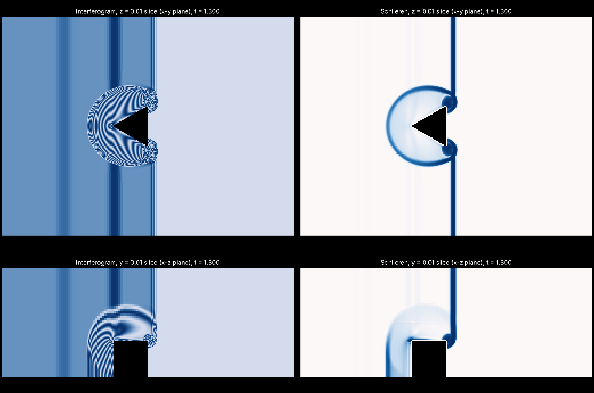

# shock_wedge_3d: Mach 1.3 shock over a finite-span wedge from STL (3D)

The 3D version of [`../shock_wedge`](../shock_wedge): the same M = 1.3 planar shock
and the same equilateral wedge cross-section, but the wedge is now a prism of
finite span 2L read from an STL file, so the flow also wraps around its end
faces. Half the span is computed, with z = 0 as the mid-span symmetry plane.



Example above: t = 1.3 with `amr.max_level=1` (finest dx = L/32), mid-span slice on top and side slice through the apex below.

## Build, run, plot

```bash
# from the repository root, AMReX checked out next to it (same commit as the main README)
cmake -S shock_wedge_3d -B build-wedge3d -DAMREX_SOURCE_DIR=../amrex
cmake --build build-wedge3d -j 8
mkdir -p results/wedge3d && cd results/wedge3d
cp ../../shock_wedge_3d/inputs ../../shock_wedge_3d/wedge3d.stl .
OMP_NUM_THREADS=8 ../../build-wedge3d/bin/shock_wedge_3d inputs
python3 ../../shock_wedge_3d/tools/slice_images.py plt00XXX                     # last plotfile
python3 ../../shock_wedge_3d/tools/slice_images.py plt00XXX --slice z=0.01 --slice z=1.5 --slice y=0.01
```

Cost on 4 cores: `amr.max_level=1` (finest dx = L/32) takes about 2 min, a good
first check. The default `max_level=2` (L/64) is roughly 30 s per coarse step on
4 cores, on the order of an hour to t = 1.3; use more cores or MPI for it.
Plotfiles open in ParaView with the AMReX/BoxLib Grid Reader for 3D views
(contour of density, or a slice coloured by |grad rho|).

## Setup

| | value |
|---|---|
| Domain | [0,8] x [-3,3] x [0,3] (wedge lengths L) |
| Wedge | `wedge3d.stl`: apex (3,0), base at x = 4, half-angle 30 deg, z in [-1,1] (computed half: [0,1]) |
| Grid | 128 x 96 x 48 base, 2 levels of ratio 2, finest dx = L/64 |
| Initial state | Rankine-Hugoniot jump for `prob.mach = 1.3`, shock at x = 2.5 (same as 2D) |
| x boundaries | inflow of the post-shock state (1) / outflow (2) |
| y boundaries | slip walls (3) |
| z boundaries | mid-span symmetry plane (3) / slip wall (3) |
| Refinement | cut cells, and density jump > 0.01 between neighbours |

The C++ is shared, nothing is copied: the solver is `../src/solver` and the
shock setup (`cns_prob*`, post-shock inflow in `CNS_bcfill.cpp`, `main.cpp`,
`CNS_init_eb2.cpp`) is `../shock_wedge/src`, which is dimension independent.
`CMakeLists.txt` here only switches the build to 3D.

## STL

`wedge3d.stl` is the closed 8-triangle prism written by
`../shock_wedge/tools/generate_wedge_stl.py --depth 2 --out wedge3d.stl`.
Change the shape with `--apex`, `--length`, `--half-angle` and `--depth`
(the span), or replace it with any closed, outward-oriented STL (a cone, a
real model); as in the sphere case, vertex coordinates are used as they are,
so keep `eb2.stl_center = 0 0 0` when the STL is already in place.

## Images

`tools/slice_images.py` cuts plane slices from the 3D plotfile (all AMR levels,
put on the finest grid) and draws the same interferogram and Schlieren as the
2D tool. Default slices: z = 0.01 (mid-span, compare with the 2D picture) and
y = 0.01 (side view through the apex, showing the shock bending round the
wedge's end). These are slices, not line-of-sight integrals like a real
Schlieren photograph.
